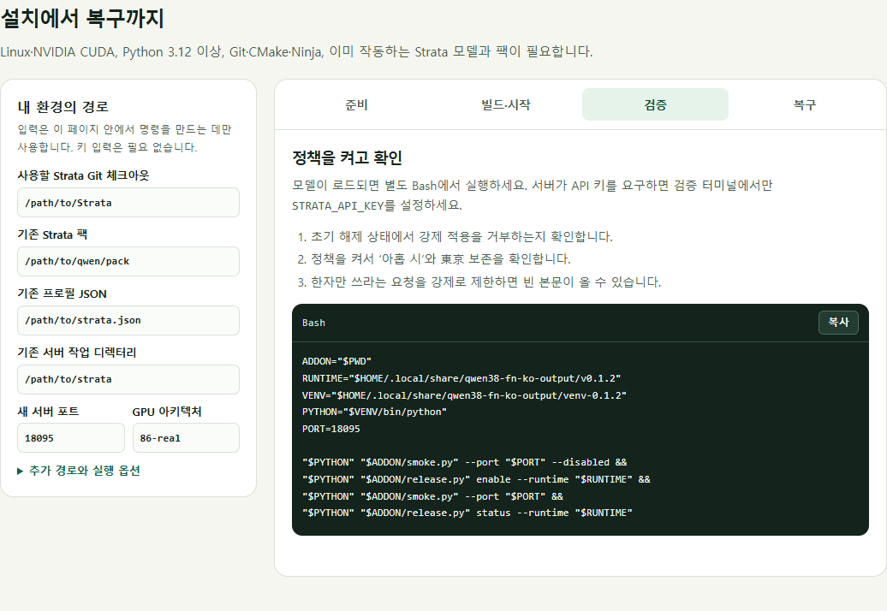

<p align="center"><a href="README.md">한국어</a> · <strong>English</strong></p>

<h1 align="center">qwen38-fn-ko-output<br>Reduce Han characters in Korean responses from Qwen 3.8 Flash Next</h1>

<p align="center">A Strata source patch that preserves Korean syllables across token boundaries and lets you disable the policy per request.</p>

<p align="center">
  <a href="https://burntgogi.github.io/qwen38-fn-ko-output/"></a>
</p>

<p align="center">
  <a href="https://burntgogi.github.io/qwen38-fn-ko-output/"><strong>Open the interactive guide (Korean)</strong></a> ·
  <a href="https://github.com/Burntgogi/qwen38-fn-ko-output/releases/tag/v0.1.2">Download v0.1.2 Preview</a>
</p>

<p align="center">
  <a href="#installation">Manual installation</a> · <a href="#how-it-works">How it works</a> · <a href="#verification-and-rollback">Rollback</a> ·
  <a href="INSTALL_FOR_AGENTS.md">Agent setup guide (Korean)</a> · <a href="docs/security-audit.md">Security and privacy audit (Korean)</a>
</p>

Follow the steps below to install, verify, and roll back the patch by hand. The release ZIP also contains an offline copy of the Korean guide at `docs/index.html`.

## Compatibility

- The target is Linux with NVIDIA CUDA, a Qwen 3.8 Flash Next pack with the verified tokenizer, and Strata's native single-request path. Live testing used ISTA-DASLab IQ3_S. The native constraint was also checked with a specific Unsloth IQ4_XS pack that uses the same tokenizer.
- The patch was developed and verified with live inference on **Strata engine 0.1.60**. The installer attempts to patch the Strata checkout you select. Build and verify the patched server on other versions before using it. [Reference Strata commit](https://github.com/Niko1221/Strata/commit/09b603886925994d0d4461857b01321ef3aa431c)
- Automatic mode uses the existing generation path when the prompt contains Han characters or asks to preserve the original text. It also passes through structured output, tool calls, image requests, and explicitly requested thinking. For constrained requests, automatic thinking and conversation checkpoints are disabled.
- Forcing the constraint on a request for Han-only output can produce an empty response with finish reason `stop`. Set `"ko_output_policy": "off"` when you need Han output. Span-by-span rewriting and automatic recovery from an empty response are experimental and are outside this preview.

## How it works

The HTTP controller sets the policy for each request. When the policy is active, the CUDA sampler filters candidate tokens by the current UTF-8 state before sampling. Accepted tokens update that state. This lets the engine assemble Korean text even when the bytes for a syllable such as `홉` span multiple tokens. The `X-Strata-Ko-Policy` response header reports the policy used. [Request and installation flowcharts (Korean)](docs/workflow.md)

## Installation

Use Python 3.12 or later, Git, CMake, Ninja, and a CUDA toolkit. Start with a working Qwen 3.8 Flash Next installation, its Strata pack, and the existing server JSON. Check that the profile's `args` array includes `"--pack", "…"`.

Download the ZIP and checksum file from the [preview release](https://github.com/Burntgogi/qwen38-fn-ko-output/releases/tag/v0.1.2), then put both files in the same directory.

```bash
sha256sum -c qwen38-fn-ko-output-v0.1.2.zip.sha256 &&
unzip qwen38-fn-ko-output-v0.1.2.zip &&
cd qwen38-fn-ko-output-v0.1.2
```

Open Bash in the extracted directory. Set `STRATA` to the Git checkout you want to use. Set `PACK`, `PROFILE`, and `WORKDIR` to the existing pack, server JSON, and the original server's working directory. Choose an unused port.

```bash
ADDON="$PWD"
STRATA=/path/to/Strata
RUNTIME="$HOME/.local/share/qwen38-fn-ko-output/v0.1.2"
PACK=/path/to/existing/pack
PROFILE=/path/to/existing/strata-server.json
WORKDIR=/path/to/original/working-directory
PORT=18095

PYTHON="$HOME/.local/share/qwen38-fn-ko-output/venv-0.1.2/bin/python"
python3 -m venv "$HOME/.local/share/qwen38-fn-ko-output/venv-0.1.2" &&
"$PYTHON" -m pip install -r "$STRATA/requirements.txt" &&
"$PYTHON" "$ADDON/release.py" prepare --strata "$STRATA" --pack "$PACK" --runtime "$RUNTIME"
```

`prepare` exports the selected checkout's current commit to a separate directory and records its ID in `runtime.json`. It uses committed files only. The original checkout stays intact. If the patch hooks or tokenizer do not match, the command identifies the failed check. The new runtime starts with the policy `off`.

### Get the reference source if needed

If you need a checkout or want to reproduce the 0.1.60 test setup, fetch the reference source into a new directory. Then use this directory as `STRATA` in the preceding commands.

```bash
STRATA="$HOME/src/strata-ko-base"
UPSTREAM=09b603886925994d0d4461857b01321ef3aa431c
mkdir -p "$(dirname "$STRATA")" &&
mkdir "$STRATA" &&
git -C "$STRATA" init &&
git -C "$STRATA" fetch --depth 1 https://github.com/Niko1221/Strata.git "$UPSTREAM" &&
git -C "$STRATA" checkout --detach FETCH_HEAD
```

### Build and start the patched server

The example uses CUDA 12.6 and `86-real` for an RTX 3090. Set `GPU_ARCH` for your GPU. If your system has several CUDA toolkits, select the correct one in CMake. Keep the outputs that `strata` loads together in `build`.

```bash
GPU_ARCH=86-real
cmake -S "$RUNTIME/source" -B "$RUNTIME/build" -G Ninja \
  -DCMAKE_BUILD_TYPE=Release -DCMAKE_CUDA_ARCHITECTURES="$GPU_ARCH" \
  -DSTRATA_ENABLE_CUDA=ON -DSTRATA_BUILD_SPLIT=OFF \
  -DSTRATA_BUILD_DSV41=OFF -DSTRATA_BUILD_TESTS=OFF \
  -DSTRATA_NATIVE_EXPERTS=ON -DSTRATA_OWN_CPU_QUANT=ON \
  -DSTRATA_Q6K_EXPERTS=ON -DSTRATA_MMQ_KQUANTS=ON
cmake --build "$RUNTIME/build" --target strata -j 2

"$PYTHON" "$ADDON/release.py" configure --runtime "$RUNTIME" \
  --profile "$PROFILE" --working-dir "$WORKDIR" --port "$PORT"
"$PYTHON" "$ADDON/release.py" serve --runtime "$RUNTIME" --offline
```

The new server listens on `127.0.0.1`. If both engines cannot fit in GPU memory, stop the original server first. The launcher reads the original JSON and uses the new engine and tokenizer paths in a temporary profile. Changes made to that temporary profile in the web UI are lost when the server restarts.

The `--offline` option enforces Strata's application-level offline mode and rejects conflicting profile settings such as remote image fetching, MCP servers, or pre-load commands. Review your profile if you need those integrations. Git and pip can use the network during installation.

## Verification and rollback

After the model loads, set the same variables in a second Bash session. If the server requires authentication, provide the existing key in the test shell's `STRATA_API_KEY` environment variable.

```bash
# Verify the disabled state, then turn the policy on and test it.
"$PYTHON" "$ADDON/smoke.py" --port "$PORT" --disabled &&
"$PYTHON" "$ADDON/release.py" enable --runtime "$RUNTIME" &&
"$PYTHON" "$ADDON/smoke.py" --port "$PORT" &&
"$PYTHON" "$ADDON/release.py" status --runtime "$RUNTIME"

# Disable the policy without restarting the patched server.
"$PYTHON" "$ADDON/release.py" disable --runtime "$RUNTIME"
"$PYTHON" "$ADDON/smoke.py" --port "$PORT" --disabled
```

`enable` and `disable` take effect on subsequent requests. If the enabled test fails, run `disable` and read the test output. The patched server can keep running with the policy disabled.

**To return to the original engine**, use `Ctrl+C` in the patched server's terminal. Start the original Strata server with its original command and profile. Restore the client address and check `/health` to confirm that the model has loaded.

The `X-Strata-Ko-Policy` header reports `on`, `off`, or a reason such as `off/preserve`. The Chat Completions request field `ko_output_policy` accepts `auto` (the default), `off`, and `on`. Forcing `on` when the operator has disabled the policy or the request is unsupported returns HTTP 400. The smoke check tests `아홉 시`, preservation of `東京`, and the difference between `on` and `off` for a Han-only request.

## What was verified

The policy was verified on two IQ3_S servers. For `v0.1.2`, both the reference commit and Strata `v0.2.15` passed source preparation and produced the same 248,320-token transition table. A mock HTTP check also passed with Control 0.1.61 in `v0.2.15`, whose engine is 0.1.60. Use the build and model checks above for the installation you plan to run. [Strata v0.2.15 release notes](https://github.com/Niko1221/Strata/releases/tag/v0.2.15)

To install with an AI agent, share the [agent setup guide (Korean)](INSTALL_FOR_AGENTS.md) and these instructions. Supply local paths. Keep API keys and full profiles out of chat and public issues.

When reporting a compatibility issue, include your Strata version, GPU, and the `smoke.py` result. [GitHub issues](https://github.com/Burntgogi/qwen38-fn-ko-output/issues)

## License

Add-on code and documentation are released under the [Apache License 2.0](LICENSE). Strata-derived code retains the [Strata MIT license and copyright notice](licenses/Strata-MIT.txt). See [NOTICE](NOTICE) for attribution.
