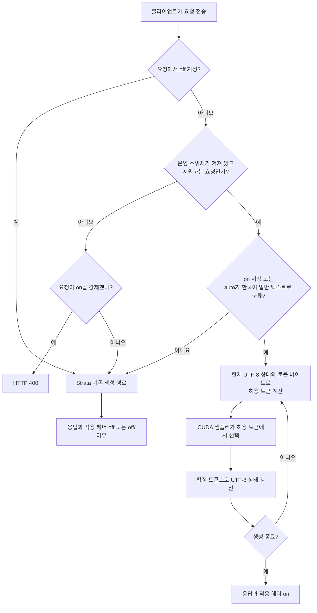
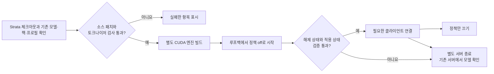

# 작동 흐름도

[설치 안내](../README.md) · [웹 안내](index.html)

## 요청 한 건이 처리되는 순서

`auto`는 요청에 한자나 원문 보존 지시가 있으면 기존 경로를 사용합니다. 한국어 일반 텍스트를 제한하는 경우에는 토큰이 글자의 중간 바이트까지만 담더라도 다음 토큰에서 이어 쓸 수 있습니다. 엔진은 글자를 완성할 수 없는 종료 토큰이나 한자를 완성하는 토큰을 제외합니다. 한자 전용 요청을 강제로 제한했을 때 글자를 한 번도 생성하지 않고 종료할 수 있습니다.

## 설치에서 복구까지

정책만 끄면 별도 엔진은 계속 실행됩니다. 기존 엔진으로 복구할 때는 별도 서버를 종료하고 원래 실행 명령과 프로필을 사용합니다.
